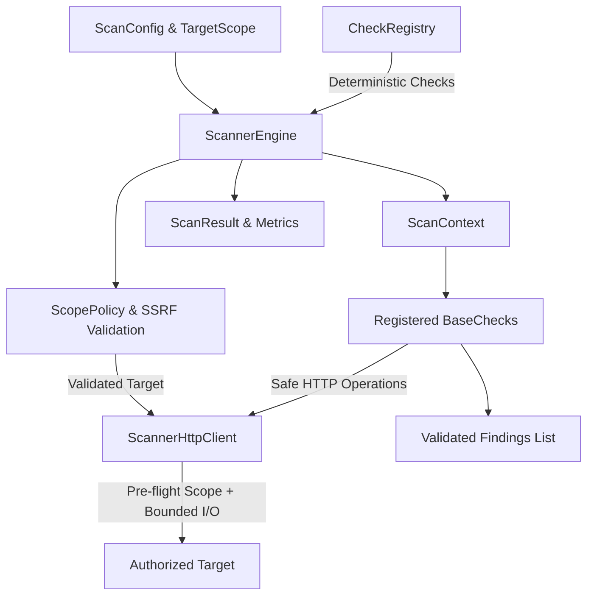

# WebVulnScanner Architecture Overview

## 1. Introduction

WebVulnScanner is a collaborative web application vulnerability assessment platform built with a modern Python (FastAPI) backend and a React (TypeScript + Vite) frontend.

> [!IMPORTANT]
> **Authorized Use Only**: This software is designed strictly for educational purposes and for assessing applications that the operator owns or has explicit, written authorization to test.

---

## 2. Monorepo Organization

```text
WebVulnScanner/
├── backend/                  # FastAPI REST API & scanner engine
│   ├── app/
│   │   ├── api/              # API versioned routers (endpoints)
│   │   ├── core/             # Configuration, logging, settings
│   │   ├── scanner/          # Safe scanner execution framework (Phase 2)
│   │   │   ├── check.py      # BaseCheck protocol & ScanContext
│   │   │   ├── client.py     # Bounded, SSRF-safe ScannerHttpClient
│   │   │   ├── engine.py     # ScannerEngine orchestrator
│   │   │   ├── models.py     # Finding, Severity, ScanConfig, ScanResult
│   │   │   ├── registry.py   # Deterministic CheckRegistry
│   │   │   └── scope.py      # TargetScope & ScopePolicy SSRF guardrails
│   │   ├── models/           # Domain and database models (future phases)
│   │   ├── schemas/          # Pydantic request/response schemas
│   │   └── services/         # Business logic and scan runners
│   ├── tests/                # Unit and integration test suite (pytest)
│   ├── requirements.txt      # Backend Python dependencies
│   └── pytest.ini            # Test runner configuration
├── frontend/                 # React + TypeScript single-page app (Vite)
│   ├── src/
│   │   ├── components/       # Reusable UI components
│   │   ├── pages/            # View pages and dashboard
│   │   ├── services/         # API clients communicating with backend
│   │   └── types/            # TypeScript interfaces
│   ├── tests/                # Vitest & React Testing Library suites
│   └── vite.config.ts        # Bundler configuration
├── docs/                     # Architectural specs, API guides, threat models
└── .github/workflows/        # Automated CI/CD pipelines
```

---

## 3. Scanner Engine Core Architecture (Phase 2)

The scanner engine establishes a safe, modular execution framework that all future vulnerability checks must adhere to:



### A. Finding Model (`app.scanner.models`)
Findings represent standardized vulnerability disclosures with strictly typed severity levels (`info`, `low`, `medium`, `high`, `critical`):
* `check_id`: Unique check identifier.
* `title`: Concise summary of the issue.
* `severity`: Severity enum instance.
* `url`: Exact target URL where finding occurred.
* `evidence`: Observed diagnostic evidence.
* `recommendation`: Remediation advice.
* Serializable to and from standard JSON.

### B. Check Interface and Registry (`app.scanner.check`, `app.scanner.registry`)
* `BaseCheck`: Abstract base class requiring `metadata: CheckMetadata` and `async def run(self, context: ScanContext) -> list[Finding]`.
* `CheckRegistry`: Central repository maintaining checks deterministically ordered by `check_id`.
  * Enforces unique check IDs.
  * Rejects duplicate registrations or non-compliant implementations.
  * Does not dynamically execute arbitrary untrusted code.

### C. Target-Scope Enforcement & SSRF Guardrails (`app.scanner.scope`)
Every outbound network action is subject to centralized `ScopePolicy` validation before any connection attempt:
1. **URL Normalization**: Normalizes scheme (`http`, `https`), downcases hostname, strips default ports (80/443), strips fragments (`#...`), and normalizes paths.
2. **SSRF Hard Blocking**: Automatically blocks requests to:
   * Loopback (`127.0.0.0/8`, `::1`, `localhost`)
   * RFC 1918 private subnets (`10.0.0.0/8`, `172.16.0.0/12`, `192.168.0.0/16`)
   * Cloud metadata services (`169.254.169.254`, `metadata.google.internal`)
   * Carrier-Grade NAT (`100.64.0.0/10`)
   * Multicast, broadcast, link-local, and reserved ranges.
3. **Controlled Lab Targets**: Local assessment can be explicitly permitted via `allow_local_lab_targets=True` without compromising default production safety.
4. **Redirect Revalidation**: Disables automatic redirect following. Every HTTP 3xx redirect is intercepted, its `Location` header resolved, and the new destination revalidated against the scope before issuing the next hop.

### D. Safe Bounded HTTP Client (`app.scanner.client`)
Built on top of `httpx.AsyncClient`:
* Pre-flight scope check executed before every request.
* Explicit connection and read/write timeouts.
* Bounded response size (default 1 MB cap) to prevent memory exhaustion and decompression bombs.
* Hard cap on total requests per session (default 50 requests).
* Clean async context management releasing socket resources.

### E. Scan Orchestrator (`app.scanner.engine`)
* Coordinates check execution using `asyncio.Semaphore` for concurrency bounding.
* Captures check failures in `ScanResult.check_errors` without disguising exceptions as successful checks.
* Supports graceful cancellation via `asyncio.CancelledError`.

### F. Backend REST API Architecture & Concurrency (Phase 4.1)
The backend exposes versioned REST API endpoints under `/api/v1` (`POST /api/v1/scans`, `GET /api/v1/checks`):
* **Target Scoping**: API requests construct an isolated `TargetScope` pinned strictly to the validated target host (`allow_subdomains=False`, `allow_local_lab_targets=False`).
* **Input Bounds**: Enforces maximum bounds on target URLs (2,048 chars) and check ID selections (maximum 50 items, 100 chars per item) using Pydantic validation with forbidden extra fields.
* **SSRF Sanitization**: Prohibited internal and cloud metadata destinations produce sanitized HTTP 422 responses (`Target destination is prohibited by SSRF security policy`) without disclosing resolved internal IPs.
* **Concurrency Model & Accepted Limitations**:
  * Scan concurrency is bounded by an `asyncio.Semaphore(10)` managed within the FastAPI application lifecycle (`app.state.scan_semaphore`).
  * The concurrency cap of 10 concurrent scans is enforced **per worker process**.
  * Deployments with multiple worker processes (e.g. multiple Uvicorn workers) scale the aggregate scan capacity proportionally (`workers * 10`).
  * Distributed rate limiting and background scan queues (e.g. Redis, Celery) are intentionally out of scope for Phase 4.1 and planned for subsequent subphases.

---

## 4. Frontend Architecture

The frontend is a single-page application built using:

* **React 19 with TypeScript**: Strongly typed component interfaces and state management.
* **Vite**: Rapid Hot Module Replacement (HMR) and optimized build bundling.
* **Component-Driven UI**: Dedicated components for target configuration, real-time scan progress, finding summaries, and exportable reports.
* **Testing**: Component and integration testing powered by Vitest and React Testing Library.

---

## 5. Security Principles

1. **Explicit Consent & Scope**: No scanning module will execute against arbitrary endpoints without explicit target scope boundaries.
2. **Safe Defaults**: Minimal initial attack surface, safe default configurations, and sanitized outputs.
3. **Auditability**: Transparent logs of requests initiated by the scanner.
4. **No Weaponized Payloads**: The engine evaluates configuration and defensive posture without running destructive exploits.
