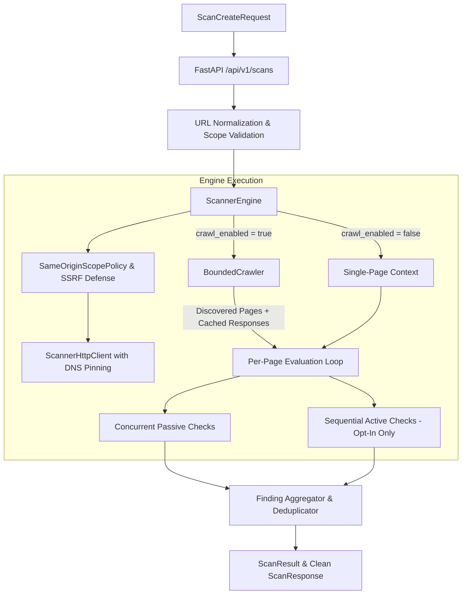

# WebVulnScanner Architecture Overview

## 1. Introduction

WebVulnScanner is a collaborative web application vulnerability assessment platform developed by **WebSec-Labs**. It features a modern Python (FastAPI) backend and a React (TypeScript + Vite) dashboard frontend.

> [!IMPORTANT]
> **Authorized Use Only**: This software is designed strictly for educational purposes and for assessing applications that the operator owns or has explicit, documented authorization to test. Scanning modules enforce strict scope boundaries, atomic request budgets, safe redirect handling, and non-destructive evaluation. Active checks require explicit opt-in.

---

## 2. Monorepo Organization

```text
WebVulnScanner/
├── backend/                  # FastAPI REST API & scanner engine
│   ├── app/
│   │   ├── api/              # Versioned API routers (/api/v1/scans, /api/v1/checks)
│   │   ├── core/             # Configuration, logging, settings
│   │   ├── scanner/          # Safe scanner execution framework
│   │   │   ├── checks/       # Passive and controlled active checks
│   │   │   │   ├── cookies.py        # Cookie security attributes (secrets discarded)
│   │   │   │   ├── cors.py           # CORS policy evaluation
│   │   │   │   ├── headers.py        # Defensive security headers (CSP, HSTS, etc.)
│   │   │   │   ├── https.py          # HTTPS configuration and transport checks
│   │   │   │   ├── http_methods.py   # Active TRACE reflection check (XST risk)
│   │   │   │   ├── http_options.py   # Active OPTIONS method discovery
│   │   │   │   └── utils.py          # Safe header and cookie parsing utilities
│   │   │   ├── crawler/      # Bounded same-origin crawler
│   │   │   │   ├── extractor.py      # Standard library HTMLParser link extractor
│   │   │   │   ├── models.py         # CrawlConfig, CrawlPage, CrawlResult
│   │   │   │   ├── normalizer.py     # Deterministic URL normalizer & origin helper
│   │   │   │   └── service.py        # BoundedCrawler async service
│   │   │   ├── check.py      # BaseCheck abstract class & ScanContext
│   │   │   ├── client.py     # Bounded, SSRF-safe ScannerHttpClient (HTTPX/HTTPCore)
│   │   │   ├── engine.py     # ScannerEngine orchestrator
│   │   │   ├── models.py     # Finding, Severity, CheckType, ScanConfig, ScanResult
│   │   │   ├── registry.py   # CheckRegistry (default and active registries)
│   │   │   └── scope.py      # TargetScope, ScopePolicy & SameOriginScopePolicy
│   │   ├── schemas/          # Pydantic request & response models
│   │   └── main.py           # FastAPI application entrypoint & lifecycle
│   ├── tests/                # Comprehensive pytest suite (264 tests)
│   ├── requirements.txt      # Backend Python dependencies
│   └── pytest.ini            # Pytest configuration
├── frontend/                 # React + TypeScript single-page app (Vite)
│   ├── src/
│   │   ├── components/       # Target configuration, progress, findings, reports
│   │   ├── services/         # Typed API client & api.test.ts
│   │   ├── types/            # TypeScript interfaces matching API schemas
│   │   └── App.test.tsx      # Vitest & React Testing Library UI integration tests
│   ├── package.json          # Node package manifest and scripts
│   ├── package-lock.json     # Deterministic npm lockfile
│   └── vite.config.ts        # Vite configuration
├── docs/                     # Architectural specs, API guides, threat models
└── .github/workflows/        # Automated CI/CD pipelines (backend-ci, frontend-ci)
```

---

## 3. Scanner Engine Architecture & Execution Flow

The scanner engine establishes a modular, defense-in-depth pipeline coordinating scope validation, HTTP transport, bounded crawling, and check execution:



---

## 4. Architectural Subsystems

### A. Target Scope Enforcement & SSRF Defense (`app.scanner.scope`)
Every outbound network operation is subject to centralized `ScopePolicy` / `SameOriginScopePolicy` validation:
1. **SSRF Hard Blocking**: Automatically blocks requests to private IPv4/IPv6 networks before and during connections:
   * RFC 1918 subnets (`10.0.0.0/8`, `172.16.0.0/12`, `192.168.0.0/16`)
   * Loopback (`127.0.0.0/8`, `::1`, `localhost`)
   * Cloud metadata endpoints (`169.254.169.254`, `metadata.google.internal`)
   * Link-local and Carrier-Grade NAT (`169.254.0.0/16`, `fe80::/10`, `100.64.0.0/10`)
   * Multicast, broadcast, and Unique Local Addresses (`fc00::/7`).
2. **DNS Rebinding Prevention (Connection-Time IP Pinning)**: Outbound sockets connect strictly to the IP addresses resolved during pre-flight validation via `SafeNetworkBackend` (built over `httpcore.AsyncNetworkBackend`), eliminating Time-of-Check to Time-of-Use (TOCTOU) DNS rebinding risks.
3. **Same-Origin Policy**: `SameOriginScopePolicy` enforces that candidate URLs share the exact `(scheme, host, port)` of the target origin.
4. **Redirect Revalidation**: Automatic redirect following is disabled in HTTPX. Every HTTP 3xx redirect is intercepted, the `Location` header resolved, and the new destination re-validated against scope before issuing the next hop.

### B. Safe Bounded HTTP Client (`app.scanner.client`)
Built on top of `httpx.AsyncClient` and `httpcore`:
* **Atomic Request Budget**: Enforces a global session cap on total HTTP requests (`max_requests`, default 50, range 1–100) across seed requests, redirects, crawler fetches, and active probes. Every dispatch atomically acquires a request slot under an `asyncio.Lock()`.
* **Streaming Response Limit**: Caps response payloads (`max_response_bytes`, default 1 MB) using chunked streaming to prevent memory exhaustion and decompression bombs.
* **Sensitive Header Stripping**: Automatically strips `Authorization`, `Cookie`, and `Proxy-Authorization` headers if a redirect navigates cross-origin.
* **Strict Timeouts**: Enforces explicit connection (`connect_timeout_seconds`, default 5.0s) and read/write timeouts (`timeout_seconds`, default 10.0s).

### C. Bounded Same-Origin Crawler (`app.scanner.crawler`)
Multi-page discovery is provided by `BoundedCrawler`:
* **HTML Link Extraction**: Parses navigational links from `<a href>` and `<area href>` tags using Python's standard-library `html.parser.HTMLParser`. JavaScript execution and form submissions are intentionally omitted.
* **Deterministic URL Normalization**: Lowercases schemes and hosts, removes fragments (`#...`), standardizes directory traversal (`..`), strips default ports (80/443), and strips embedded user credentials (`user:pass@host`).
* **Resource Bounds**: Enforces maximum crawl depth (`max_depth`, default 2, max 5) and maximum page count (`max_pages`, default 10, max 50).
* **Target Protection**: Crawler concurrency is constrained by an internal semaphore (`min(max_concurrency, 2)`) to avoid overwhelming target servers.

### D. Check Registry & Classification (`app.scanner.check`, `app.scanner.registry`)
Checks implement the `BaseCheck` interface and are categorized into distinct types via `CheckType`:
* **Passive Checks (`CheckType.PASSIVE`)**:
  * Analyze already-fetched HTTP responses without issuing additional network requests.
  * In single-page mode, `ScanContext.get_baseline_response()` lazily fetches the root page once with GET under an `asyncio.Lock()` and caches it for all passive checks.
  * In multi-page mode, passive checks reuse the crawler's cached response for each page with zero additional network overhead.
  * Four default checks: `security_headers`, `cookie_security`, `cors_security`, `https_configuration`.
* **Active Checks (`CheckType.ACTIVE`)**:
  * Deliberately issue targeted network probes to assess specific configuration properties.
  * **Explicit Opt-In Required**: Active checks are disabled by default (`active_checks_enabled: false`). Submitting active check IDs without opt-in returns `HTTP 400 Bad Request`. Target authorization is never inferred from URLs or responses.
  * **Sequential Execution**: Active checks execute sequentially per page after passive checks, preventing server flooding and race conditions against the request budget.
  * Two non-destructive checks:
    * `http_trace_method`: Probes RFC 7231 / RFC 9110 reflection using a diagnostic probe header (`X-Scan-Trace-Probe`). Documents browser mitigations and classifies findings as defense-in-depth (`Severity.LOW`).
    * `http_options_method`: Probes RFC 9110 method advertisement via the `Allow` header. Strictly informational (`Severity.INFO`) and does not claim exploitability.

### E. Fault Isolation & Cancellation Semantics (`app.scanner.engine`)
* **Page & Check Isolation**: Exceptions during check execution or page crawls are recorded in `ScanResult.check_errors` and `ScanResult.failed_pages` without discarding findings from successfully scanned pages.
* **Request Budget Exhaustion**: When `max_requests` is reached, `RequestLimitExceededError` halts further dispatches, preserves all partial findings, and sets scan status to `PARTIAL`.
* **Cancellation Propagation**: `asyncio.CancelledError` sets `ScanStatus.CANCELLED` on the scan result and is re-raised cleanly through the API layer, releasing concurrency permits and closing underlying HTTP connections.
* **Internal Data Hygiene**: The crawler's internal response cache (`crawl_result.responses`) is discarded upon scan completion and never serialized into public API responses (`ScanResponse`).

---

## 5. Security Principles & Limitations

1. **Explicit Consent & Scope**: Scanning is constrained to authorized hostnames. Subdomains and external origins are excluded by default.
2. **Safe Defaults**: All scans default to single-page, passive-only execution (`crawl_enabled: false`, `active_checks_enabled: false`).
3. **Secret Redaction**: `ParsedCookie` explicitly discards cookie values during parsing. Findings and evidence never retain credentials or auth tokens.
4. **No Destructive Exploits**: The active-check framework strictly evaluates diagnostic configuration without fuzzing, state-changing verbs (POST/PUT/DELETE bodies), or authentication bypasses.
5. **Defense-in-Depth vs. Absolute Proof**: Automated test suites and security boundaries verify that implemented checks behave deterministically and respect configured policies. However, automated testing cannot guarantee the absence of all possible vulnerabilities on target systems. Operators must combine automated tooling with rigorous manual review and explicit authorization.
